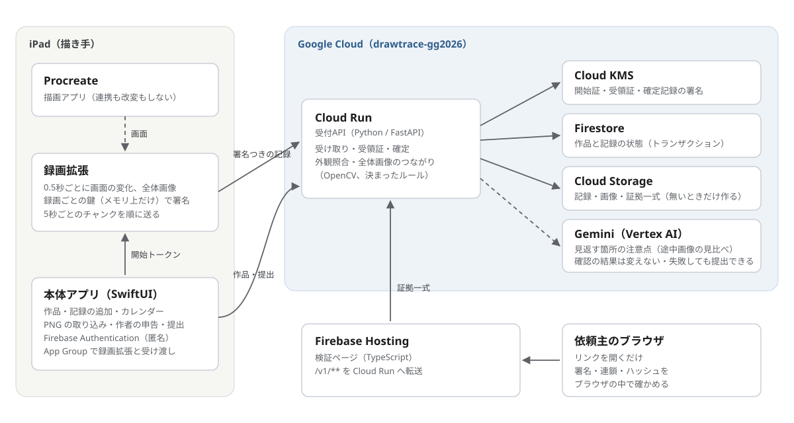

# Canvault

**イラストの納品に、確かめられる制作記録を添える。**

Canvault は、iPad の Procreate で描くイラストレーターが、制作中の記録を完成画像と一緒に渡せるアプリです。描き手は納品時にリンクを共有し、依頼主はブラウザで制作の流れ、記録の整合性、提出画像との対応を確認できます。

DevFest GDGoC Japan Hackathon 2026・クリエイティブ部門｜チーム **EstiMeip**

| ブラウザで試す | 見どころ |
| --- | --- |
| [実機で描いた木の制作記録](https://drawtrace-gg2026.web.app/p/b_5nC-kP0-kaupnEwwDlAA) | 途中画像、記録が届いた時刻、提出画像との照合結果をたどれます。 |
| [画像が大きく変わる検証用の記録](https://drawtrace-gg2026.web.app/p/ij2emL2A0JFbvH9Dofypaw#process) | 紫の「AI の注意点」から、見返す区間と画像に見える変化を読めます。 |
| [記録の書き換えを検出する試験データ](https://drawtrace-gg2026.web.app/?fixture=tampered_header) | ヘッダを1バイト変えた箇所を、ブラウザが署名の不一致として表示します。 |

## 疑いを晴らす負担が描き手に偏る

SNS では、イラストに「AI で描いたのでは」と疑いがかけられる場面をよく目にします。依頼で描いた作品でも、疑いがかかると、制作の経緯を説明する負担は描き手にかかります。

制作動画だけでは、依頼主が撮影時刻を独立して確かめるのは難しいです。Canvault は、描いている間に記録を受け取り、その時点で署名した受領証を残します。納品時にリンクを添えれば、依頼主は同じ記録を自分のブラウザで確認できます。

## 録画から納品まで

1. **記録する。** iPad で録画を始め、Procreate で描きます。録画拡張は画面の変化を5秒ごとの記録にまとめ、キャンバス全体が表示されたときの途中画像とともに署名して送ります。日をまたいでも、同じ作品に記録を追加できます。
2. **作品を確定する。** 描き手が完成 PNG を取り込み、AI の使用について申告します。サーバーは終了画面と PNG の外観を照合し、確定記録と証拠一式を作ります。
3. **リンクで確認する。** 依頼主のブラウザが、端末と運営の署名、記録のつながり、件数、画像のハッシュを検証します。受信に空きがあった場所や、終了画面と提出画像の照合結果も読めます。



## Google 技術を選んだ理由

| 技術 | Canvault での役割と採用理由 |
| --- | --- |
| **Cloud KMS** | 受領証と確定記録を署名します。署名鍵をアプリやコンテナに配らずに運用でき、依頼主のブラウザは公開鍵で検証できます。 |
| **Cloud Run** | 記録の受付、OpenCV による画像照合、作品の確定を同じ API で処理します。制作の開始や納品に合わせて負荷が変わるサービスを自動でスケールできます。 |
| **Cloud Firestore と Cloud Storage** | Firestore のトランザクションで、同時に届いた操作でも記録の先頭や作品の状態をそろえます。Storage では未作成のときだけ書き込む条件を使い、再送で記録が二重に保存されるのを防ぎます。 |
| **Firebase Authentication と Hosting** | 匿名認証で描き手ごとの作品を管理します。Hosting は検証ページを配信し、API も同じオリジンから呼べるようにします。依頼主はアカウント登録なしでリンクを開けます。 |
| **Gemini Flash（Vertex AI）** | 選んだ途中画像の前後を見比べ、線や構図のつながりを追いにくい箇所を文章にします。長い制作記録から依頼主が見返す場所を探すために使います。 |

## 何を確認できるようにしたか

作者の申告、決まった手順による確認結果、Gemini の注意点を、画面で分けて表示します。依頼主が確認できるのは、運営の鍵で署名された記録の整合性、運営が記録した受信時刻、提出 PNG と終了画面の外観上の対応です。手描きかどうか、AI を使ったか、誰が操作したかは作者の申告や別の情報とあわせて判断する事項です。[検証ページの表示と範囲](docs/verification.md)

描き手が公開範囲を選べるよう、途中画像の公開設定と作品の削除を用意しました。受信や確定の再送・同時実行はサーバーのテストで、署名の不一致や画像の差し替えはブラウザの試験データで確認できます。[検証用の試験データ](tools/fixtures/README.md)

## コードと動作確認

| ディレクトリ | 内容 |
| --- | --- |
| `ios/` | SwiftUI の iPad アプリ、ReplayKit 録画拡張、共通の Swift パッケージ TraceKit |
| `server/` | FastAPI の受付・照合・確定処理、Cloud Run のデプロイスクリプト |
| `web/` | TypeScript と WebCrypto によるブラウザ検証、試験データ |
| `shared/` | JSON Schema、署名のテストベクタ、画像比較のパラメータ |
| `infra/`・`tools/` | Google Cloud と Firebase のセットアップ、テスト画像・試験データの生成 |

```bash
(cd server && python -m pip install -r requirements-dev.txt && python -m pytest -q)
(cd web && npm ci && npm test && npm run build)
(cd ios/TraceKit && swift test)
```

Web を手元で確認する場合は `web` で `npm run dev` を実行し、`http://localhost:5173/?fixture=normal` を開きます。iPad アプリは `ios/DrawTrace/DrawTrace.xcodeproj` を Xcode で開き、開発チームと Firebase の設定を行います。実機の対象は iPadOS 18.5 以降、Procreate を使った縦持ちでの記録です。コードやデプロイ先には開発時の名前 `DrawTrace` が残っています。[環境の準備](infra/README.md)

ソースコードのライセンスは [MIT](LICENSE) です。実機の試験画像と編集画面の見本には、Savage Interactive の Procreate の画面を使用しています。
